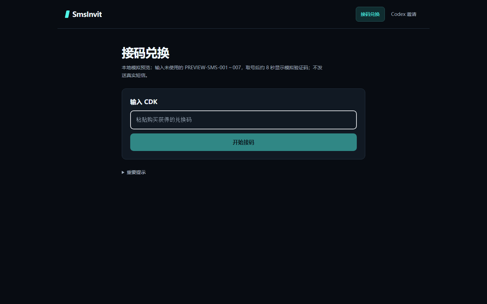
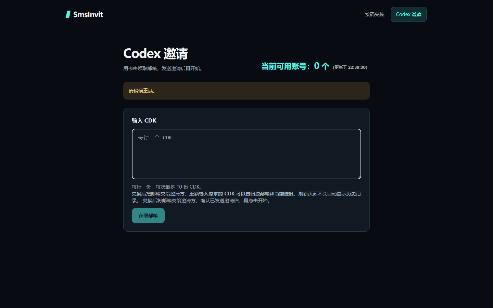

# SmsInvit

把「手机号接码」和「ChatGPT 账号 + Codex 邀请」做成可以用卡密兑换的自建服务。
前台用户自己输卡密取号、领号、取验证码；后台统一管套餐、卡密、成本和运行记录。




## 它能做什么

**短信接码**

- 用户用卡密兑换一个手机号，去目标站点触发短信，回来点「取验证码」就能拿到码。
- 支持同号多码、换号、取消重试；号码全局只租一次，已尝试或结果不明的号不会再用。
- 每次租号、取消、补偿都记账，后台按币种分开统计成本，未定价的行标「未定价」而不是当 0。

**Codex 邀请**

分两段，互不影响：

1. **账号工厂**：拿池化邮箱 + 代理，把邮箱注册成 GPT 账号、绑好 2FA 就停住，攒成待兑换的号池；
   池子低于阈值时自动补号（可开关、可设并发）。
2. **用户兑换**：用户输卡密领一个号并立即绑定，同一邮箱不会被第二张卡密取走；
   用户点「开始」后自动走「查邀请信 → 恢复登录 → 接受邀请 → Codex OAuth 换 RT → 接码 → CLI → 导出」。

**管理后台**

套餐与价格、卡密批次（含独角「批量录入 / CSV」格式导出）、接码兑换记录、邀请运行与失败复核、
邮箱池、代理池、接码价格与余额、通知渠道、审计日志、持久任务与定时任务、后台登录 IP 封禁。

## 怎么跑起来

### 依赖

- Python ≥ 3.12
- Node ≥ 24，pnpm 10.24
- MySQL 8.4
- 真实的邀请执行需要 Linux（Landlock + seccomp）；Windows / macOS 只能跑前台和模拟预览

### 安装

```bash
python -m venv .venv
.venv/bin/pip install -r apps/api/requirements.lock          # Windows: .venv\Scripts\pip
pnpm install --frozen-lockfile
pnpm build:shared && pnpm build                              # 生成 apps/{web,admin}/dist
```

### 本地跑一遍（隔离库 + 模拟供应商，不连真实上游）

```bash
# 指向一个一次性 MySQL；也可以写进 data/test-private/mysql.json（该目录不进仓库）
export SMSINVIT_PREVIEW_MYSQL='{"host":"127.0.0.1","port":"3306","user":"root","password":"..."}'
python scripts/local_preview.py            # Windows 先 set PYTHONUTF8=1
```

打开 <http://127.0.0.1:3010/>，后台 <http://127.0.0.1:3010/admin/>，管理员 `admin / 123456`，
模拟卡密 `PREVIEW-SMS-001` … `PREVIEW-SMS-007`（取号后约 8 秒出现验证码）。
脚本会自己建表、造套餐、造卡密、造管理员，并把供应商请求全部拦成 503。

细节（MySQL 免安装部署、环境变量、停止命令）见 [本地启动](docs/local-run.md)。

### 生产部署

统一镜像 + Caddy 入口 + 私有网络 MySQL，步骤见 [部署说明](deploy/README.md)。

必填三个密钥：`SMSINVIT_INVENTORY_ENCRYPTION_KEY`、`SMSINVIT_INVENTORY_FINGERPRINT_KEY`、
`SMSINVIT_JWT_SECRET`；`worker-enabled` 要显式打开才会跑后台任务。

## 怎么用

### 接码：从建套餐到用户取码

1. 后台「套餐」新建 `SMS_REDEEM` 套餐：选接码服务、国家、价格带、卡密有效天数。
2. 「卡密批次」里生成一批卡密，导出 CSV 或文本（可直接喂给独角）。
3. 把卡密交给用户。用户在前台输入卡密 → 拿到号码 → 去目标站点触发短信 → 回前台点「取验证码」。
4. 取不到码可以换号；取消/重试的规则由套餐和运行配置决定。

### 邀请：账号工厂 + 用户兑换

1. 后台「邮箱管理」导入池化邮箱，「代理池」导入代理；「接码价格」可查各平台余额。
2. 「服务配置」里打开账号工厂，设阈值与并发，让它把邮箱注册成可兑换的 GPT 账号（到 2FA 停住）。
3. 建 `CODEX_INVITE_REDEEM` 套餐并发卡密；用户在 `/supprot_codex` 输卡密领号。
4. 用户按提示发送邀请信后点「开始」，后台自动跑完邀请 → OAuth → 取码 → 导出 RT。
5. 结果不明（超时、网络断）时保留原单和写前状态，进入「待复核」，不会自动重放。

### 谁都别乱点：先看模拟环境

`scripts/local_preview.py` 是零风险练习场：卡密、号码、验证码、余额全是本地造的，适合先熟悉界面再上真实供应商。

## 配置

| 项 | 作用 |
| --- | --- |
| `SMSINVIT_CONFIG_FILE` | 私有运行时配置（YAML/JSON）；同名 `SMSINVIT_*` 环境变量优先 |
| `SMSINVIT_SUPPLIER_ALLOWED_HOSTS` | 接码上游出站白名单，`host:port` 精确匹配，未列入的直接拒绝 |
| `SMSINVIT_INVITATION_ALLOWED_HOSTS` | 邀请侧出站白名单（邮箱 API、导出面板等） |
| `smsinvit.worker-enabled` | 后台调度总开关；关闭时同步兑换仍可用 |
| `smsinvit.invitation-worker-enabled` / `-pool-enabled` | 邀请执行 / 账号工厂补号，两个独立开关 |
| 供应商地址与密钥、套餐价带 | 后台页面维护，落库后加密存储 |

运行时配置项清单：`apps/api/smsinvit/common/runtime_catalog.json`。

## 目录与技术栈

```
apps/api        FastAPI：接码、邀请、公共与管理 API，同源提供前台与后台静态文件
apps/web        用户端（React 18 + Vite + Tailwind）：/supprot_sim、/supprot_codex
apps/admin      管理端（React 18 + Ant Design Pro）：/admin/
packages/*      共享 TS 包（错误码、文案、tsconfig）
vendor/codex_invit  Codex 邀请引擎（注册、邮箱、OAuth、CLI 执行、导出）
migrations      SQL 迁移（Flyway 风格，带校验和）
scripts         迁移、备份恢复、发布打包、镜像扫描、本地预览
deploy          compose、Caddy、环境变量样例
```

Python 3.12+ / FastAPI / SQLAlchemy / MySQL 8.4；React 18 / TypeScript / Vite / Turbo / pnpm。

## 安全与运维要点

- 库存密钥、供应商密钥、账号凭据、TOTP secret 全部加密落库；卡密明文只在有导出权限的详情里出现，每次读取写审计。
- 卡密、号码、邮箱都用 HMAC 指纹去重，防止跨模块重复兑付。
- 后台登录：密码 + 算术验证码 + 可选 TOTP；按账号和按 IP 双限流，连续输错封 IP。
- 出站请求走白名单 + 公网地址校验；邀请执行子进程在沙箱边界内运行，只注入本次代理。
- 迁移前向、带校验和；数据库分权限账号，DDL 与备份用独立账号。

```bash
python scripts/migrate.py --status     # 校验迁移历史与表结构
python scripts/migrate.py              # 追加缺失版本
```

## 开发

```bash
pnpm typecheck && pnpm lint && pnpm test && pnpm build
python -m pytest apps/api/tests scripts/tests        # 需装 requirements-test
ruff check apps/api/smsinvit apps/api/tests scripts
```

需要真实 MySQL 的用例默认跳过，提供 `data/test-private/mysql.json` 才会连一次性库。

## 许可

[MIT](LICENSE)。第三方组件与来源见 [THIRD_PARTY_NOTICES.md](THIRD_PARTY_NOTICES.md)。
